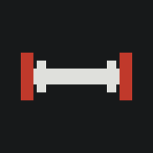
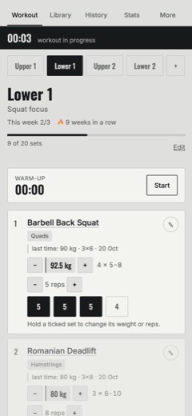
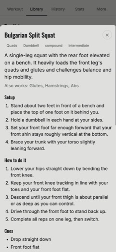
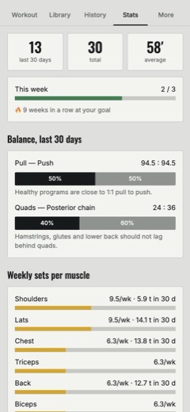
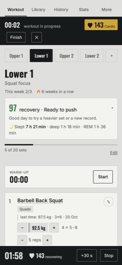
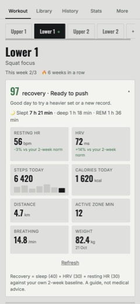
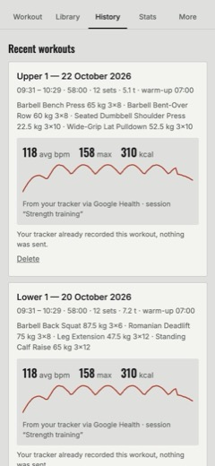
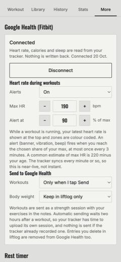
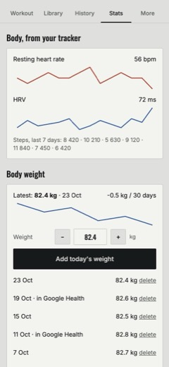

<div align="center">



# liftlog

**A private workout tracker you own, with your Fitbit built in.**<br />
Plan your training, log every set, learn every exercise, see your **live heart rate, recovery and sleep** from a Fitbit or Pixel Watch, and keep all of it in *your* database. Free, open source, installs on your iPhone like an app.

[](https://github.com/boardotmeme-dot/liftlog/actions/workflows/ci.yml)
[](LICENSE)


[**Try the demo**](https://liftlog-neon-iota.vercel.app) · [**Self-host in 15 minutes**](docs/SETUP.md) · [**Connect your Fitbit**](docs/GOOGLE-HEALTH.md) · [**Install on iPhone**](docs/INSTALL-ON-PHONE.md)

</div>

<p align="center">
  
  &nbsp;
  
  &nbsp;
  
</p>

<p align="center">
  
  &nbsp;
  
  &nbsp;
  
</p>
<p align="center"><sub>Fitbit / Pixel Watch integration (optional): live heart rate while you lift, a recovery score from your sleep and HRV, and a heart-rate chart on every workout. Screenshots use invented demo data.</sub></p>

---

> **Project status:** liftlog is early-stage software (v0.2). Keep a recent JSON backup; features and the data format may change before 1.0. See the [changelog](CHANGELOG.md).

## Why liftlog

Most workout apps want an account on *their* server, a subscription, and your data. liftlog is the opposite:

* **You own the data.** Deploy your own copy and connect your own free [Supabase](https://supabase.com) database. Nobody else, including the author of this project, can see your training. [How privacy works →](docs/PRIVACY.md)
* **Works without any server.** Skip the database and everything stays in your browser. Add it later when you want sync between devices.
* **Feels like a real app.** Install it from Safari to your Home Screen, use it offline in the gym, with a rest timer and the screen kept awake.
* **Knows how your body is doing.** Connect a Fitbit or Pixel Watch and liftlog shows live heart rate during sets, a recovery score, sleep and HRV next to your training. [See how →](#fitbit-and-pixel-watch-integration)
* **Teaches you the lifts.** 124 exercises, each with setup, steps, cues, common mistakes and hand-picked video references with previews.
* **No lock-in, no tracking, no ads.** MIT licensed. Export everything as JSON any time.

## Features

| | |
|---|---|
| **Training** | Multi-day plans, per-set weight and reps (hold a set to edit), rest timer that adapts to compound vs isolation lifts, warm-up ramp for barbell lifts, plate calculator, timed sets for planks and holds |
| **Cardio days** | Jump rope, bike, run, walk, rowing, swimming, elliptical, outdoors or indoors. A day is a program of timed steps: warm-up, work, rest, cool-down, repeated in rounds. Styles such as speed intervals, boxer rounds, Tabata, tempo, fartlek and run/walk, all editable. Big countdown, sound and vibration at each change, pause and skip, live heart rate, distance and pace afterwards |
| **Library** | 124 exercises for the gym **and for home** (bodyweight, dumbbells, kettlebell, band), search and filters, **Top lists** such as *Top 10 with no equipment* and *The big compound lifts*, one tap to turn a list into a workout day |
| **Your own exercises** | Create exercises with steps, cues and **video links**: paste a YouTube link and the title, author and preview are filled in automatically |
| **Starter plans** | Full body 3 days, upper/lower 4 days, full body 4 days, home with no equipment, home with dumbbells |
| **Progress** | Personal records and estimated 1RM, weight charts, weekly goal and streak, push/pull and quad/posterior balance, sets per muscle per week, days since each muscle was trained, plateau detection |
| **Sync** | Optional accounts with your own Supabase project. Workouts are separate records, so two phones never overwrite each other's history |
| **Units** | Kilograms or pounds (US plates and 45 lb bar built in). Data is stored in kg, so you can switch freely |
| **Body weight** | A weight log with trend, synced between devices, optionally mirrored to Google Health |
| **Fitbit / Pixel Watch** *(optional)* | Live heart rate with alerts, recovery score, sleep, HRV and trends, heart rate and calories on every workout, optional write-back of workouts and weight. Runs through your own Supabase. [See below ↓](#fitbit-and-pixel-watch-integration) |
| **Offline** | Installable PWA, works without a connection, syncs when you are back online |

## Get started

### 1. Just look around (30 seconds)

Open the [**live demo**](https://liftlog-neon-iota.vercel.app). Without signing in, everything is saved only in your browser.

> The demo is a shared playground run by the project author. Do not rely on it for long-term data; host your own copy for that.

### 2. Run it on your computer

```bash
git clone https://github.com/boardotmeme-dot/liftlog.git
cd liftlog
npm install
npm run dev
```

Needs [Node.js 20+](https://nodejs.org). That is a complete app running at the printed address, no accounts needed.

To verify the checkout before making changes:

```bash
npm test
npm run build
```

### 3. Your own private copy online, with sync (recommended)

You need two free accounts: **Supabase** (the database) and **Vercel** (the hosting). The full, click-by-click guide is in **[docs/SETUP.md](docs/SETUP.md)**. In short:

1. Create a Supabase project and run the SQL files in [`supabase/migrations`](supabase/migrations) (`0001` and `0003`; `0002` only for the Fitbit integration).
2. Deploy to Vercel and paste two values (your project URL and public key).
3. Open your site on your iPhone and **Add to Home Screen**.

[](https://vercel.com/new/clone?repository-url=https%3A%2F%2Fgithub.com%2Fboardotmeme-dot%2Fliftlog&env=VITE_SUPABASE_URL,VITE_SUPABASE_ANON_KEY&envDescription=Your%20Supabase%20project%20URL%20and%20public%20(anon%2Fpublishable)%20key&envLink=https%3A%2F%2Fgithub.com%2Fboardotmeme-dot%2Fliftlog%2Fblob%2Fmain%2Fdocs%2FSETUP.md%233-connect-the-app-to-supabase&project-name=liftlog&repository-name=liftlog)

Create the Supabase project and run the SQL **before** you press the button, then you will have the two values ready. [Step by step →](docs/SETUP.md)

## Fitbit and Pixel Watch integration

An optional module that connects liftlog to the **Google Health API** (the successor of the Fitbit Web API) so your training and your body live in one place. It works with Fitbit trackers and Pixel Watches, was built and tested with a **Fitbit Air**, and runs entirely through **your own** Supabase project and **your own** Google Cloud app.

### What you get

<table>
<tr>
<td width="50%" valign="top">

**Live heart rate while you lift**<br />
Your current heart rate sits in the top bar, coloured by zone (easy, fat burn, cardio, hard, max). Between sets it tells you if you are *recovering* or *recovered*. Pick your max heart rate and an alert level, and liftlog warns you with a banner, vibration and beep when you get there.

**Recovery score**<br />
0-100 from last night's sleep, today's HRV and your resting heart rate, compared with *your own* two-week norm. It ends in a plain suggestion: *Ready to push*, *Normal day* or *Take it easy*.

**Today panel**<br />
Sleep with deep and REM, resting heart rate, HRV, steps with a 7-day chart, calories, distance, active zone minutes, breathing rate and weight.

</td>
<td width="50%" valign="top">

**Heart rate on every workout**<br />
After you finish, liftlog attaches average, max and min heart rate, a heart-rate chart and calories to the workout in your history.

**Trends**<br />
Two-week resting heart rate and HRV, weekly steps, and a body-weight log with trend (the weight log also works without a tracker).

**Send data back (opt-in)**<br />
Allow writing and liftlog can send finished workouts, with your exercises and sets in the notes, and your body weight to Google Health. It never duplicates a session your tracker already recorded, and removes what it added when you delete the entry.

**Private by design**<br />
Tokens stay on your server, permissions are read-only unless you switch writing on, and one tap disconnects.

</td>
</tr>
</table>

<p align="center">
  
  &nbsp;
  
</p>

### How it works

```
phone ──▶ liftlog (browser) ──▶ Supabase Edge Function ──▶ Google Health API ──▶ your Fitbit data
                                 keeps the Google secret and token;
                                 you own it, the browser never sees a token
```

The tracker uploads to Google about once a minute, liftlog asks your Edge Function for the latest sample every ~20 seconds during a workout, so "live" is near-live. Everything in the full guide below is explained in detail.

### Set it up (about 20 minutes)

You need liftlog running with Supabase accounts ([SETUP.md](docs/SETUP.md)), the **Google Health** app on your phone signed in with the account your tracker uses, and a free Google Cloud project.

1. **Google Cloud:** create a project, enable the **Google Health API**, set the consent screen to *External / Testing* and add yourself as a test user, add the three **read-only** scopes (activity and fitness, health metrics and measurements, sleep), and create a **Web application** OAuth client with the redirect URI `https://<your-project-ref>.supabase.co/functions/v1/health-callback`. Copy the Client ID and Client secret.
2. **Database:** run `supabase/migrations/0002_google_health.sql` (and `0003_body_logs.sql` for the weight log) in the Supabase SQL Editor.
3. **Functions and secrets:**
   ```bash
   supabase link --project-ref <your-project-ref>
   supabase functions deploy health
   supabase functions deploy health-callback --no-verify-jwt
   supabase secrets set GOOGLE_CLIENT_ID=... GOOGLE_CLIENT_SECRET=... APP_URL=https://your-site.vercel.app
   ```
4. **Switch it on:** add `VITE_ENABLE_GOOGLE_HEALTH=true` to your Vercel environment variables and redeploy.
5. **Connect:** in the app open **More → Google Health (Fitbit) → Connect**. On Google's page choose **Advanced → Go to liftlog** (Google shows an "unverified app" notice for your own app) and allow the read-only permissions.
6. **Optional:** to send workouts and weight back, add the two `writeonly` scopes in Google Cloud and press **Allow writing** in the app.

The complete guide, with every setting, the exact data used, privacy details and a troubleshooting table, is **[docs/GOOGLE-HEALTH.md](docs/GOOGLE-HEALTH.md)**.

### Good to know

* Google treats all Health API permissions as *restricted*. An unverified app (every self-hosted copy) works for **up to 100 people** and shows Google's "unverified app" screen once. In *Testing* mode connections last **7 days**; the guide shows how to publish your own app for long-lived connections.
* On a **shared demo**, anyone who connects stores their Google token in the host's database, and the app tells them so first. For private use, host your own copy. A server owner can restrict the integration to specific accounts with the `HEALTH_ALLOWED_EMAILS` secret.
* Not every tracker records everything (the Fitbit Air has no SpO₂ or VO₂ max, so those are not shown).
* To look at the screens without a tracker, build with `VITE_HEALTH_DEMO=true`: the interface fills with invented data (this is how the screenshots above were made).

## Install on your phone

| iPhone / iPad | Android | Desktop |
|---|---|---|
| Safari → **Share** → **Add to Home Screen** | Chrome → **⋮** → **Install app** | Chrome / Edge → install icon in the address bar |

Details, tips and troubleshooting: **[docs/INSTALL-ON-PHONE.md](docs/INSTALL-ON-PHONE.md)**.

## How your data is protected

* Your training data lives in **your** Supabase project and syncs directly from the browser. There is no central server operated by the liftlog authors; the optional Fitbit integration uses Edge Functions inside your own Supabase project.
* Every table has **Row Level Security**: the database itself only returns rows belonging to the signed-in user.
* The browser only contains public values (project URL and anon/publishable key). Never add the secret `service_role` key to the app, Vercel or git; Supabase provides it automatically and only server-side to the optional Edge Functions.
* Third-party requests are limited to YouTube (thumbnails and, only after you tap play, the privacy-enhanced player) and, only if you enable the Fitbit integration, Google's own Health API through your server. Fonts are bundled, there are no analytics or trackers.

Read the details in **[docs/PRIVACY.md](docs/PRIVACY.md)** and **[SECURITY.md](SECURITY.md)**.

## Support and bug reports

Found a bug or have a feature idea? Search the [existing issues](https://github.com/boardotmeme-dot/liftlog/issues), then [open an issue](https://github.com/boardotmeme-dot/liftlog/issues/new/choose). Please report security vulnerabilities privately as described in [SECURITY.md](SECURITY.md).

## Contributing

Adding an exercise is as easy as adding one JSON file, and the CI checks it for you. Fixing a dead video link is a great first pull request.

* [CONTRIBUTING.md](CONTRIBUTING.md) — how to add exercises, collections and code
* [catalog/SCHEMA.md](catalog/SCHEMA.md) — exercise format and the rules for video references
* [CODE_OF_CONDUCT.md](CODE_OF_CONDUCT.md) — how we treat each other
* [docs/ARCHITECTURE.md](docs/ARCHITECTURE.md) — how the app is built

## Tech

Preact, TypeScript and Vite as a PWA. Supabase (Postgres, Auth, Row Level Security, and Edge Functions in Deno for the optional Fitbit integration) for optional accounts and sync. Vitest for tests. There is no component library or analytics SDK; Inter and Oswald are bundled locally through Fontsource.

## Roadmap

Supersets, importing from other apps, sharing a plan by link, more languages, more exercises, a nicer chart for each lift, other wearables (Garmin, Polar, Oura), Health Connect on Android. Ideas and pull requests welcome.

## Documentation

| Guide | What it covers |
|---|---|
| [SETUP.md](docs/SETUP.md) | Your own copy with Supabase and Vercel, step by step |
| [INSTALL-ON-PHONE.md](docs/INSTALL-ON-PHONE.md) | Add liftlog to your iPhone, Android or desktop |
| [GOOGLE-HEALTH.md](docs/GOOGLE-HEALTH.md) | The Fitbit / Pixel Watch integration: features, setup, settings, limits, troubleshooting |
| [PRIVACY.md](docs/PRIVACY.md) | Exactly what is stored where, and who can read it |
| [ARCHITECTURE.md](docs/ARCHITECTURE.md) | How the app, the sync and the integration are built |
| [CONTRIBUTING.md](CONTRIBUTING.md) | Add exercises, collections or code |
| [SECURITY.md](SECURITY.md) | Reporting vulnerabilities, security model |
| [CHANGELOG.md](CHANGELOG.md) | What changed in each version |

## Credits and licence

Code and exercise descriptions: [MIT](LICENSE). Linked videos belong to their authors; liftlog only shows their public preview and links to the original. If you are an author and would like a link removed, open an issue and it will be taken out.

Medical note: liftlog is a logbook and a learning aid, not medical advice. Start light, use good form, and talk to a professional if you have an injury or health condition.
